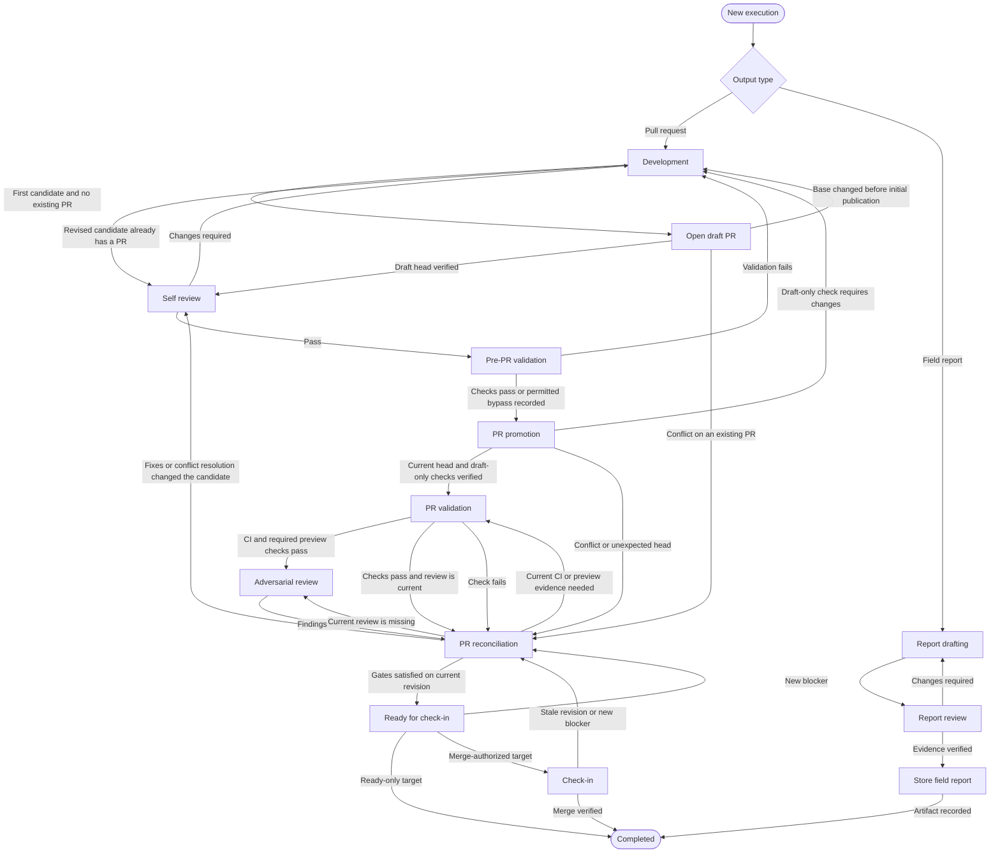
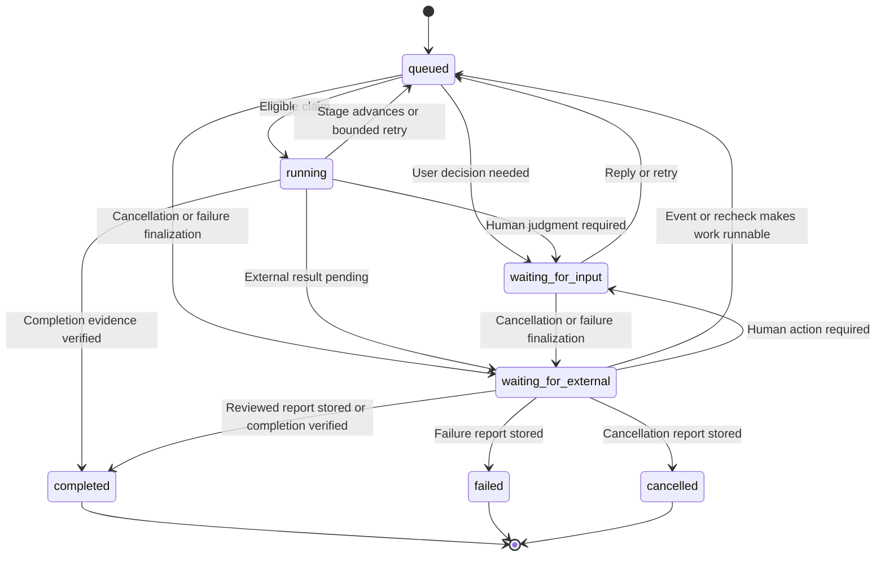

# Phalanx work item state machine

The transition tables and rules in this Markdown document define Phalanx’s behavior. The diagrams and [HTML visualization](state-machine.html) are visual references. If a diagram differs from the transition rules, correct the diagram against the rules.

Each execution has a **stage**, which describes what must happen next, and a **status**, which describes whether it can happen now. For example, `pr_validation / waiting_for_external` can mean the current PR head is awaiting CI. The server owns both values. A worker attempts one stage and reports its outcome and evidence. The server determines the transition and releases or reassigns the slot.

Phalanx tries to self-resolve within the work item’s scope and the repository’s rules. Fix failing tests, reconcile routine conflicts, and address actionable review feedback independently when the expected result is clear. Ask for human judgment when competing choices would materially change the requested behavior, an approval is required, or continued attempts cannot make progress. Record material assumptions and how they were verified.

## Lifecycle stages

The arrows below apply only when their guards pass. A blocked guard keeps the stage and changes the execution status. Record evidence against the candidate revision. After PR publication, use the PR identity, head, and base revision where relevant. A changed head invalidates prior head-bound evidence. Recheck base-sensitive evidence when the base moves.

| Stage | Event or evidence | Next stage or disposition |
| --- | --- | --- |
| `development` | Scoped changes have a recoverable candidate commit. | `pr_creation` for a new draft. If the item already has a PR, proceed to `self_review` on the new candidate. |
| `pr_creation` | Publish the candidate as a draft, record the PR, and verify its head. | `self_review`. Return to `development` if a base change requires a new candidate or to `pr_reconciliation` if an existing PR conflicts. Reuse a matching PR after interruption. If a bounded search cannot confirm publication, retry creation rather than drop the deliverable. If duplicates appear, select a primary and surface the others for review. |
| `self_review` | Candidate diff has been checked against the work item and repo rules. | `pre_pr_validation` if it passes. `development` if fixes are needed, with the findings carried into the next development packet. |
| `pre_pr_validation` | Before requesting review, run applicable local tests and available live checks. Record the revision and results, or the skipped checks and reason for a permitted bypass. | `pr_promotion` after passing or recording a permitted bypass. Actionable failures return to `development` with the failed checks as findings. |
| `pr_promotion` | Update the existing PR to the validated candidate if needed, verify its head, and complete checks that must run in draft. Mark a draft ready for review once those gates pass. | `pr_validation`. Keep a previously promoted PR open for review when updating it. Wait for draft-only external checks without holding a slot. Failures requiring code changes return to `development`; an unexpected head or conflict goes to `pr_reconciliation`. |
| `pr_validation` | Observe CI and perform required preview validation for the current PR revision. Wait for pending checks or previews with a scheduled recheck. | Advance to `adversarial_review` after required checks pass, or to `pr_reconciliation` if an independent review is already current. Send failures to `pr_reconciliation` to diagnose and resolve. |
| `adversarial_review` | An independent reviewer records findings and severity against the current PR diff. | `pr_reconciliation`, including when there are zero findings. An interrupted review can retry on the current revision. |
| `pr_reconciliation` | Resolve conflicts, address actionable review comments, and confirm CI, previews, review, approvals, and mergeability for the current revision. | Candidate changes return to `self_review` and reuse the existing PR on the next publication. Missing or stale CI or preview evidence returns to `pr_validation` when a new check or result is expected. Missing or stale review returns to `adversarial_review`. Diagnose failures before retrying. Proceed to `ready_for_check_in` only when all required evidence is current. |
| `ready_for_check_in` | Verify current PR identity, head, base, and gates against the completion target. | Complete a ready-only item. Advance to `check_in` when merge is authorized. A new blocker returns to `pr_reconciliation`; missing authorization waits for input. An explicit change to a ready-only target can complete the item. |
| `check_in` | Recheck merge authorization, required approvals and checks, and the expected head before requesting merge. Verify the resulting merge through GitHub. | Complete with PR link and merge commit. A stale head, conflict, or failing check returns to `pr_reconciliation`. An unknown merge outcome waits for reconciliation before retry. |
| `report_drafting` | Produce a recoverable Markdown draft. | `report_review` |
| `report_review` | Check the draft against the request and verify supporting evidence and links. | `report_storage` when it passes. Return to `report_drafting` for fixes. |
| `report_storage` | Store the reviewed Markdown idempotently and record its reference. | Complete with the stored report. Retry storage failures without redrafting. |

If GitHub reports the PR already merged, verify the merge matches this work item and the expected candidate before recording completion. An unexpected merge or a PR closed without merge requires a decision if the action’s intent cannot be established. Never open a replacement PR just because an existing one is closed.

Record the trusted runner's independent review against the PR revision assigned by passing gates. Before queuing check-in, persist the runner's authorization and operation ID against the primary PR and exact ready revision. Accept merge completion only when the current check-in claim supplies the verified provider merge commit and its ordered parents, matching the authorized base and candidate head. See the [runner PR observation contract](docs/runner-pr-observations.md) for required evidence.

## Repository validation policy

- Each repo can define applicable pre-validation commands, when they may be skipped, draft-only checks, expected CI, and required previews. Start from repository instructions and GitHub’s required checks. If no CI is expected or required, advance. If expected CI is absent, recheck and surface a blocker if it stays missing.
- Run candidate-local pre-validation before uploading an update. Run checks that need a published candidate after the candidate reaches the PR. Check draft-only gates before promotion and post-promotion CI afterward. If a previously promoted PR needs a check that can only run in draft, follow the repo policy for rerunning it or ask for a decision when the policy leaves the path unclear.
- Pre-validation runs before promotion by default. A work item can request a bypass for urgency, or the runner can skip checks that repo policy marks inapplicable to the change. Record the candidate revision, affected checks, reason, and basis for authorization. Record a bypass as skipped, and retain any earlier failures. Draft-only gates, CI, required previews, and check-in rules still apply.
- A changed PR head invalidates candidate-bound checks, CI and preview evidence, and independent review for the old head. A changed base invalidates mergeability and checks tied to the old merge candidate, and requires review of the new diff if it changes. Head-only evidence may carry forward when its inputs are unchanged and repo policy allows it. Recheck the provider’s latest approval and merge gates before check-in.
- If someone pushes outside Phalanx, reconcile the new head and revalidate it. Continue when the changes fit the work item. Ask for judgment if scope or intent is unclear. Preserve the external change rather than overwriting it.

## Execution status

| Event | Server behavior |
| --- | --- |
| Eligible claim | Check dispatch pause, capacity, repo and runtime eligibility, and all upstream milestones in the claim operation. Assign one current lease and a new attempt only when all prerequisites are satisfied. Bind the claim to their exact executions and output revisions. A blocked item retains the unmet prerequisite and reason. A failed or cancelled prerequisite prompts recovery, redirection, or cancellation of the dependent work. |
| Prerequisite satisfied | Recheck all prerequisites and make the dependent item eligible when its last required output is verified. Keep unrelated items runnable. Reconcile missed notifications by checking durable milestone records before claims and on recheck. |
| Valid stage result | Check attempt ID, current lease, state version, stage, and evidence. Atomically record the outcome and timeline event. Queue the next runnable stage or persist the appropriate wait or final result. Apply the final-output guard before any terminal transition. |
| Retryable failure or expired lease | Reconcile the known worker session, checkpoint, and outputs. If the writer is still running or has a verified result, adopt the same open attempt under a recovery claim. The claim replaces the expired lease secret and is accepted only after expiry, so it cannot race a renewal. Retry a stopped attempt with bounded backoff. Unknown session state warrants a recheck before replacement. A late result cannot advance the item on an expired lease. Before repeating a GitHub operation, reconcile what happened. |
| Human judgment required | Save one focused question, the options, any proposed default, and the handoff. Release the slot and notify the user. A reply queues the stage again with that context. |
| External gate pending | Save the gate and expected revision, release the slot, and recheck periodically as well as on events. A result schedules the work needed to continue. Escalate persistent stalls or conflicting evidence. |
| Repeated lack of progress | Stop repeating the same ineffective attempt. Try a scoped recovery with a different path when evidence supports it. Otherwise ask for a decision with prior attempts and a recommended next action. Release the slot and keep unrelated eligible work running. Reservations for live or uncertain processes still apply. The user can reply, retry, redirect, or close the execution. |
| Cancel requested | Stop new work. For active work, record the cancellation request and reconcile any in-flight publication before marking it cancelled. If the merge already succeeded, record that verified outcome. |
| Finalize a report | Record the terminal intent and release the attempt before storage. The server retries independently of dispatch. Store or reuse the exact report and close the execution in one transaction. |
| Rerun a closed execution | Create a linked execution with an explicit target. Preserve history and reconcile any existing branch, PR, or report before repeating effects. |

Before yielding a slot, record the workspace, candidate revision or local checkpoint, relevant validation evidence, and remaining work. Keep the item on the same runner while a required checkpoint exists only there. If that runner cannot recover, ask whether to rebuild from the last durable checkpoint or close the execution.

## Final output guard

- A `completed`, `failed`, or `cancelled` execution always has exactly one final output. A running, queued, or waiting execution may have progress notes, a draft report, or a PR link without a final output. The requested output type remains in the work item even if its final output differs.
- On successful PR work, the final output is the verified PR link and head, with the merge commit when the completion target is `checked_in`. On successful report work, the final output is the stored reviewed Markdown report.
- On failure or cancellation without the requested deliverable, the final output is a Markdown report with the disposition, last stage, what was attempted, the blocker or reason for stopping, partial artifacts, and any useful next action. A partial PR can be linked from the report. The server can produce the report from the execution history even when the worker has exited or work was cancelled before the first claim.
- Store the final output reference and terminal status together. If output storage fails, keep the execution open with a retryable finalization step. Reuse an existing matching artifact and leave a conflicting artifact intact for investigation. The server retries after 2, 4, 8, and 16 seconds. After five recorded failures, the execution wait and timeline show the blocker. The owner can restore database access or resolve the report integrity issue, then POST the current expected version to the execution’s `retry-finalization` endpoint. A full database outage leaves the intent due and appears in server logs while the API cannot record retry history.

## Transition tests

Cover a report and a PR through completion, ready-only without merge, pre-PR checks passing or explicitly bypassed, a required CI failure after bypass, PR-only preview checks, new comments, conflicts, changed heads or bases, and a retry that discovers an existing PR or successful merge. Exercise duplicate submissions and events, a stale worker result, a lost external notification, a failed prerequisite, interruption during cancellation, and a review loop with no progress. Verify that failure and cancellation produce a report, including cancellation before the first claim, and that a storage outage leaves finalization retryable. For every active state, verify a next action, a persisted resume trigger, or an explicit way to close the execution.

For dependency coverage, test parallel prerequisites across repos, a downstream item waiting for the last prerequisite, ready-only evidence held until a required merge, a failed upstream item that produces a report, cycle rejection, and eligibility changes after steering.
