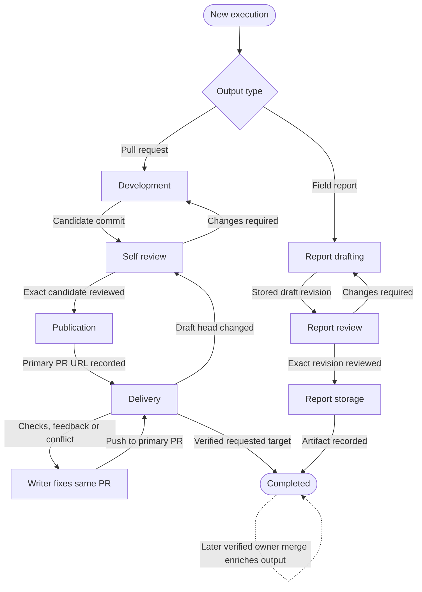
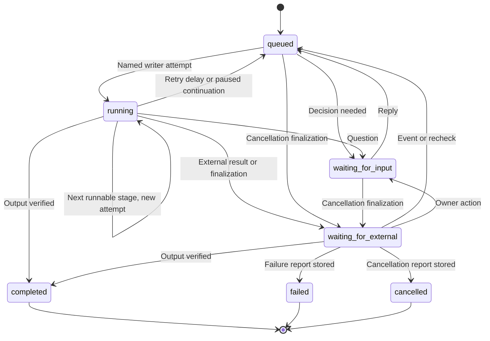

# Phalanx work item state machine

The transition tables and rules here are authoritative. The diagrams and
[HTML visualization](state-machine.html) illustrate them. An execution has a **stage**
(what happens next) and **status** (whether it can happen now). The server owns both.
One registered writer remains with its item; each attempted stage is separately fenced.

Workers self-resolve within scope and repository rules. Fix routine failures, conflicts and
feedback; ask for judgment or missing authority only when necessary. Record assumptions,
evidence, prior work and a concrete resume action.

## Lifecycle stages

A completed direct `ready_for_check_in` execution also accepts `pr_observed` for its primary PR.
If it merged into the target at the verified ready head, or the reconciler proves that head is an
ancestor of the merged PR head, the server enriches the existing final PR output with the final
revision, merge commit and GitHub's `merged_at`. Status stays `completed`, target stays unchanged,
and the board outcome becomes `checked_in`. This idempotent terminal enrichment refreshes
dependent eligibility in the same transaction. An open PR, closed-unmerged PR, wrong base,
unrelated head, draft output, or already-recorded merge never changes terminal state.

| Stage | Required event or evidence | Next stage or disposition |
| --- | --- | --- |
| `development` | Scoped changes committed as a recoverable full candidate SHA. Repository checks and instructions apply. | `self_review`. Reconcile existing branches/PRs before repeating writes. |
| `self_review` | Review the exact candidate against the request, correctness and repository rules; record notes and reviewed candidate. | `publication` on success; `development` with findings for changes. Bounded repeated findings ask for input. |
| `publication` | Writer pushes the deterministic item branch and opens or reuses one PR with the explicit target base. Honor publication mode and current target. Report its URL; it must belong to the registered repo and not be a PR merged by an earlier execution. | `delivery`, waiting for trusted reconciler observations. No `changes_required` here: fix the same PR during delivery. |
| `delivery` | Trusted timestamped GitHub observation of the recorded primary PR and exact head. GitHub wins over cached facts. | Verified requested target completes. Failed/pending checks, feedback, conflict, changed head or wrong base remain visible waits/flags for the writer. Closed without merge asks for input; a reply queues delivery. |
| `report_drafting` | Submit recoverable Markdown; server stores a content-addressed draft. | `report_review`. |
| `report_review` | Check exact draft against the request, evidence and links; submit its revision. | `report_storage` on success; `report_drafting` with findings otherwise. |
| `report_storage` | Submit the reviewed revision; store it idempotently. | Complete atomically with the report. Retry storage without redrafting. |

### Publication and delivery targets

For ready publication the writer marks a reused draft ready and enables GitHub auto-merge
**only** for `checked_in`. A `ready_for_check_in` item is never merged by its writer. Steering
between PR targets is allowed while open, including delivery; the writer re-reads the target
and disables auto-merge when retargeted to ready-only. New work on a completed item requires
a rerun; recording a later verified owner merge only enriches its existing final output.

An open primary PR on the correct base, ready for review, at a head whose required checks
are green, with no unresolved feedback or conflict reaches `ready_for_check_in`. That
completes ready-only work, or records the milestone while checked-in work awaits merging.
Required ready checks come from trusted policy. Missing policy/checks wait visibly; they
cannot invalidate an actual verified merge.

With `publication_mode: "draft"`, the writer opens a draft or converts the reused PR to draft
and disables auto-merge. It never promotes or merges. Delivery completes only when the
reconciler verifies the primary PR open, unmerged, draft, on the deterministic item branch,
at the self-reviewed candidate and target base. It records `draft_published`, with no
`ready_revision`, and satisfies no ready/check-in prerequisite. A changed head queues
`self_review` for the observed candidate; a wrong base or ready PR keeps waiting.

A verified merge into the target by **anyone**, via merge, squash or rebase, completes either
PR target. Record final head, merge commit, method and time. A merge commit must contain
the final head as its second parent; a single-parent squash/rebase commit must be reachable
on the base with the PR's verified final head. No Phalanx merge intent is required on the
direct path. A merge into another base asks the owner. Never open a replacement just because
the primary PR closed. An owner merge after ready-only completion releases checked-in
dependents when observed. Older observations cannot overwrite newer facts except a merge.

Trusted local checks are reconciler flags, not a Phalanx gate (D3). Writers follow repository
checks; GitHub reviews, checks and rulesets gate merging. Optional post-merge deployment
observations are flags, not stages or delivery gates.

### Closed execution history

Schema migration 20 normalizes removed stage names only on completed, failed or cancelled
execution snapshots to `delivery`. Outputs, versions, timestamps, attempts and immutable
transition history are retained. Historical timelines may still show their original names;
they are evidence, not runnable stages. Closed ready PRs still accept later verified owner
merges under the same terminal enrichment rules.

## Execution status

| Event | Server behavior |
| --- | --- |
| Writer registration | Check expected version, named execution eligibility, dispatch pause, prerequisites and charter writer limit. Atomically enforce one open writer. An unbound queued item visibly awaits a direct Captain. |
| Named writer attempt | Verify the current scoped token and runnable state. Assign a new attempt and pin exact upstream executions/output revisions. A wait exposes its reason and resume trigger. |
| Valid result | Check attempt, writer binding, version, stage and evidence. Record outcome and history atomically; end that attempt. Open the next runnable attempt for the same writer or retain the writer through the wait. Old attempts/tokens cannot advance state. |
| Paused dispatch | Refuse new registrations and attempts. Existing attempts can post progress/results. Resume makes runnable work available again. |
| Prerequisite satisfied | Re-evaluate durable milestones in bounded batches and at claim time. Unrelated items remain runnable. Failed/cancelled upstream work never qualifies through its disposition report. |
| Human judgment | Save question/options/default/handoff and notify. Captain replies record `answered_by: captain`; owner is the default. Reply queues the same stage, retaining its writer and context. |
| External wait | Store reason, gate, expected revision and due recheck. Events or bounded jittered polling resume it. Delivery observations can complete directly without another attempt. |
| Interrupted writer | No timed expiry. Verify native state, exact session and preserved local work. Discover uncertain launch by nonce before launching. Replacement must name the current writer and attest it stopped; revoke old credential atomically. |
| Repeated lack of progress | Bound retries/repeated findings and ask for a decision with prior attempts and next action. Silence and stale-progress flags alone do not authorize replacing a writer. |
| Cancel requested | Stop new work and reconcile in-flight effects; confirm the exact worker stopped. If a merge succeeded, record it rather than claiming cancellation. Store a disposition report when needed. |
| Finalize report | Persist terminal intent, then store/reuse exact artifact and close atomically. Retry independently of pause. |
| Rerun | New linked execution with explicit target; preserve old history and reconcile existing outputs before repeating effects. |

Capture worktree, candidate/checkpoint, evidence and remaining work before yielding. A required
checkpoint that exists only locally pins recovery to that host until safely preserved.

## Final output guard

- Every `completed`, `failed` or `cancelled` execution has exactly one final output.
- Successful PR work records verified PR/head and the merge commit for checked-in delivery.
  Draft-only completion is distinct from ready delivery. Successful report work records the
  reviewed Markdown.
- Failure/cancellation without the requested output stores a disposition report: last stage,
  attempts, reason, partial artifacts and useful recovery action. It can link a partial PR.
- Store output and terminal status together. A storage outage leaves retryable finalization,
  never a closed row without output. Retry after 2, 4, 8 and 16 seconds; after five failures
  show the blocker. Owner `retry-finalization` uses the current expected version. A complete
  database outage leaves the intent due and logs the storage error.

## Transition tests

Cover PR/report completion, both PR targets, draft ceiling/head re-review, all merge methods,
owner merges, target steering, failed checks/feedback/conflicts, exact reviewed revisions,
duplicate/idempotent posts, stale credentials, lost launches, racing Captains, stopped writer
replacement with preserved work, pause, questions/replies, cancellation, report-storage
outages and reruns. Cover loading, listing, board rendering and reconciliation for closed
executions carrying every removed stage value before migration.

Dependency coverage includes parallel cross-repository prerequisites, exact output pins,
ready-only versus merged milestones, failed upstream reports, cycles, missed notifications,
and eligibility changes after steering. Every open state needs an action, resume trigger or
explicit recovery path.
