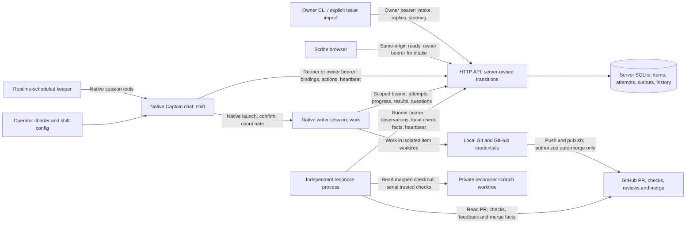
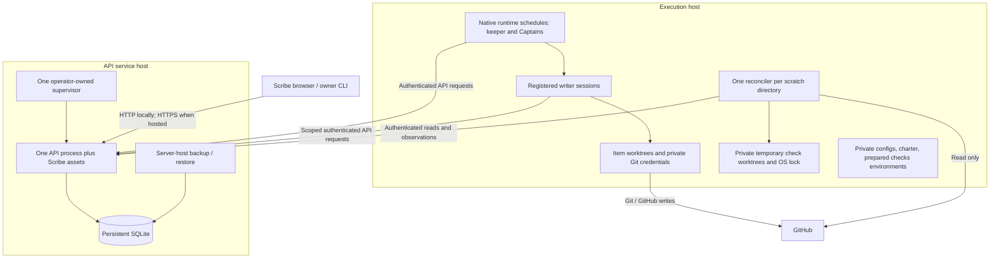

# Relay-free direct-session architecture

This implementation map was audited against `main` at `641dbb7` (November 24, 2026).
It describes shipped code, not proof that a particular installation has deployed it.
[SPEC.md](../SPEC.md) defines the product,
[STATE_MACHINE.md](../STATE_MACHINE.md) owns transitions, and
[direct sessions](direct-sessions.md) specifies the coordination contract.

**Relay-free does not mean server-free.** The retired relay was the Captain chat
transport used by the old scheduling loop. The FastAPI HTTP API and Scribe dashboard
are still running components. The old `captain`, `relay` and `attended*` CLI paths,
numbered slots, runner-only PR executors and client SQLite journals were removed in
[#209](https://github.com/caltseng/phalanx/pull/209) and
[#214](https://github.com/caltseng/phalanx/pull/214). Historical decisions and pilot
results referring to them are not instructions for a second execution path.

## Components and ownership



The arrows name the initiating caller, not an API push channel. Scribe polls the API;
Captains inspect native sessions themselves; writers submit their own results.
The reconciler also reads registered repositories and execution pages from the API.
It does not launch sessions, write GitHub, or merge PRs.

| Boundary | Authoritative state / responsibility | Implementation |
| --- | --- | --- |
| API and database | Items, dependencies, executions, attempts, questions/replies, reports, bindings, actions, observations and flags; atomic transitions and finalization | [API startup](../phalanx/api.py), [store](../phalanx/store.py), [intake](../phalanx/intake.py), [transitions](../phalanx/transitions.py) |
| GitHub | PR identity, actual head/base, checks, feedback, merge and deployment facts | [GitHub reader](../phalanx/github.py), [reconciliation](../phalanx/reconciliation.py) |
| Captain runtime | Native launch/discovery, coordination, trust-block escalation, shift handoff and creator-owned cleanup | [shift client](../phalanx/shift.py), [Captain prompt](../phalanx/prompts/captain.md), [keeper prompt](../phalanx/prompts/keeper.md) |
| Pickup projection | One eligibility/reason decision from live Captain scope/readiness snapshots, persisted waits and canonical capacity; shared by discovery, Scribe and overdue flags | [pickup](../phalanx/pickup.py), [operator views](../phalanx/operator_api.py), [flags](../phalanx/flags.py) |
| Writer runtime | Implement, run repository checks, self-review, commit, publish, and fix its primary PR through delivery | [writer binding](../phalanx/writers.py), [work CLI](../phalanx/work_cli.py), [worker prompt](../phalanx/prompts/worker.md) |
| Execution host | Mapped checkouts, isolated item worktrees, Git credentials, prepared checks environments, scoped credential files and artifacts | [workspaces](../phalanx/workspaces.py), [configuration](configuration.md) |
| Reconciler | Read provider facts independently, post timestamped observations, run trusted local checks serially and notify on owner-needed flags | [reconciler](../phalanx/reconciler.py), [validation policy](validation-policy.md) |

Execution clients never open the queue database. `server backup` and `server restore`
are explicit **server-host-only administration**, not an alternative client state path.
Local credential/pending-intent files and OS locks support launch replay and exclusion;
they are not local execution journals. Unpushed work remains on its host.
Writer display names are task-first and may collide or change. Verify the full nonce
in kickoff/metadata and the registered native ID; titles are not writer identity.

## Intake and supported commands

The [CLI dispatcher](../phalanx/__main__.py) exposes `register`, `intake`, `ingest-issue`,
`inspect`, `inbox`, `reply`, `cancel`, `onboard`, `shift`, `work`, `reconcile`, `muster`,
`deploy` and server-host `server backup|restore`. `phx` in the guides is a configured
local shorthand, not a separately installed executable.

- Owner `intake`, the owner API and Scribe's **New work item** use the same intake
  contract. Intake defaults to `checked_in`; choose `report`, `ready_for_check_in`
  or a draft publication ceiling explicitly.
- `ingest-issue` reads a registered github.com issue/comments with the local GitHub
  credential and submits an immutable snapshot. It is not a webhook, poller or sync.
- `onboard` registers/verifies a remote, clone, mapping and proposed validation entry.
  The operator still prepares checks environments, copies reconciler mappings and
  grants runtime trust. It does not start sessions.
- `shift` is a client used **inside a native Captain chat**, not a background Captain
  loop. Runtime schedules wake Captains and the keeper. `shift current` reads the server's
  unique live active registration across all history; native tools verify its binding/link
  before off-shift chats forward owner input. The tracked
  [forwarding section](../phalanx/prompts/forwarding.md) is composed into Captain/keeper prompts
  and handoffs; retained chats require an explicit relay after deployment.
- `work` runs from the item's worktree and reads its scoped credential from the Git
  directory. Do not copy it, expose it or substitute the Captain's runner token.
- `muster status` discovers existing configuration and reads authenticated API status.
  `deploy init` separately creates new-install templates; neither is a process watchdog.

See [installation](install.md), [work items](work-items.md), [writer operations](writer-operations.md)
and [API reference](api.md) for executable examples and authentication.

## One writer, separately fenced stages

```mermaid
sequenceDiagram
    accTitle: Writer launch, stage results and delivery verification
    accDescr: A Captain registers and confirms one native writer. Separately fenced stage results advance through publication. The reconciler posts GitHub facts and the API verifies output.
    participant C as Native Captain
    participant A as HTTP API and SQLite
    participant W as Native writer in item worktree
    participant G as GitHub
    participant R as Reconciler
    C->>C: Verify checkout/base, prepare worktree and pending nonce/credential
    C->>A: Register writer intent (expected version, token digest)
    A-->>C: Binding and eligible first attempt
    C->>W: Launch once by nonce using native tools
    C->>A: Confirm native session ID/link
    W->>A: work status / next
    loop Development and self-review
        W->>W: Perform stage, repository checks/review where required
        W->>A: Submit result pinned to attempt, stage and version
        A-->>W: End attempt, bind next runnable attempt or wait
    end
    W->>G: Push item branch, open or reuse one primary PR at explicit base
    W->>A: Publication result with primary PR URL
    A-->>W: Delivery wait, no open attempt, writer stays registered
    opt Actionable delivery flags
        W->>A: Request Building; wait for granted allocation
        W->>G: Fix checks, feedback or conflicts on the same PR
        W->>A: Release Building with reviewed publication head
    end
    R->>G: Read exact PR, checks, feedback and verified merge facts
    R->>A: Timestamped observation (no worker attempt)
    A->>A: Derive flags, verify requested output, close and end writer
    Note over A,G: Ready-only stops before owner merge, checked-in waits for GitHub merge
```

PR stages are `development -> self_review -> publication -> delivery`. Self-review
findings return to development. Publication records one primary PR, then delivery
normally waits without an open attempt. Ready-mode delivery fixes stay on that PR,
without stage results; after an owner reply queues delivery, the writer resumes,
acts on the reply and submits success. A changed draft-only head instead queues
self-review, then republication of the same PR URL.

Reports use `report_drafting -> report_review -> report_storage`. Review and storage
name the exact content-addressed draft. The server stores the reviewed report and
terminal output atomically, retrying finalization without redrafting.

Status is separate from stage. Input, dependency, retry and external waits retain
the writer; pause blocks new registrations and Building acquisitions, not an allocated writer's stage continuation.
Writer bindings have no timed expiry. Nonce replay, expected versions and stopped-session
attestation prevent duplicate writers and stale submissions, not runtime trust or review.

The writer self-review stage is not a second independent PR reviewer. GitHub reviews,
checks and repository rules still apply. The generated writer instructions require
applicable independent final exact-head approval, green required CI, required GitHub reviews
and repository/dependency/actual-main gates **before** merge or auto-merge activation.
Publication can finish first with auto-merge off and the same writer waiting in delivery.
This prompt boundary adds no engine approval predicate, review agent or lifecycle stage.
Self-review and previous-head/content-only approval cannot satisfy independent final review.
The reconciler's observations do not certify that review. Trusted local-check failures
are flags, not another Phalanx delivery gate. Required ready checks come from trusted
policy; missing policy is not success. A verified merge into the target by anyone
completes either PR target, with `merge` or combined `squash_or_rebase` provenance.
Ready-only writers never merge or enable auto-merge. Later owner merges can enrich
completed ready outputs and release check-in dependencies without restarting writers.
Optional deployment checks observe the delivered **merge commit**; they are flags,
not stages, and never reopen delivery.

## Deployment and recovery boundaries



These are ownership boundaries, not a claim that multiple hosts are deployed.
Local first means API and execution host may be the same machine. The API does not
need checkout mappings or GitHub credentials. Hosting requires HTTPS, persistent
storage, authentication and backups; multi-user tenancy and multi-device handoff
remain separate work.

[Deployment tooling](deployment.md) provides foreground service entrypoints and a
database-adjacent OS lock for `deploy run server`; raw Uvicorn does not acquire that
lock. One supervisor owns each service. Reconciler scratch locking is independent.
Templates do not install a supervisor, launch sessions or deploy themselves. Adoption
on an existing installation is a reviewed service-owner operation preserving paths,
database, tokens, active writers and capacity; never initialize a replacement database
or restart another owner's services from a writer.

After an API restart, bindings, attempts, replies and outputs survive in SQLite.
After a Captain loss, existing writers and the reconciler continue; a keeper/fresh
Captain reconciles API, GitHub and native inventory. `shift.launch` prepares the worktree
and persists/replays a reservation; the Captain's native create and writer confirmation
are separate effects, not a transaction. Complete those three steps per item before
reserving another. After interruption, search fresh full inventory and verify the full
nonce in kickoff/metadata. Confirm a match, or replay the same reservation only after
proving absence and no in-flight native create. Inconclusive inventory/replay is an
explicit blocker. Scribe and Captain status show reservation age and the recovery
action without claiming native execution; the existing ten-minute alert notifies the
owner. No background launcher or timeout-based release is introduced.
Replace only the exact stopped
writer after preserving local work and accounting for external effects. An API HTTP 401
ends that writer's control access; inspect terminal state through an authorized
Captain/owner, not by manufacturing a new credential. Stale heartbeat/progress flags
alone never prove a process stopped. Follow [resume](resume.md) and [recovery](recovery.md).

Activation requires the service owner to deploy the API/CLI projection and flag changes
and refresh retained Captain instructions from the packaged prompt verbatim. Existing
reservations and allocations remain in place; there is no schema/configuration change.
Writers do not restart services or patch retained/live configuration to activate this.

### Shipped code is not installation state

The two writer limits are persisted in `dispatch_settings`: `max_building_writers` (Building,
initially five) and `max_writers` (Total, initially ten on new installs), editable as an atomic
pair by the owner. `writers.building` is the authoritative allocation; `building_requested_at`
persists rework waits and FIFO preference for eligible PR fixes. Registration/acquisition and
release run inside the same SQLite write transaction as writer/stage changes. Successful
self-review releases Building into publication; delivery fixes explicitly reacquire it.
`executions.handoff_head` fences the reviewed commit awaiting publication across restart.
A mismatched open head has a visible `head_drift` flag and board wait. GitHub merges remain
authoritative; ending/withdrawing/replacing the writer clears the handoff for recovery.
Counts, board waits and dispatch-overdue/backlog reporting use `dispatch`'s same state/helpers,
not stage-derived guesses or a second budget. Intents and waiting writers retain Total.
`shift launch` supplies no limit, and charters reject concurrency keys; `deploy init` writes
only `max_hours = 24` for elapsed-time rotation. Existing stores retain their saved Total, all live writers and
conservative Building allocations. Shipped code does not prove installation state: follow
[separate deployment and activation](deployment.md#two-limit-writer-activation); do not treat
approval or an open PR as deployment.
`shift heartbeat` compares the Captain's registration age with freshly loaded charter
`max_hours` (default 24). `shift wake` uses the returned server heartbeat timestamp for age,
prints a compact briefing and adds the fresh canonical workflow every 90 elapsed minutes.
The Captain row's `reinforced_interval` is the last acknowledged registration-relative
90-minute interval. `PUT /v1/captains/{id}/reinforcement` advances it monotonically only
after the Captain reads that output. Non-wake heartbeats never touch it; retries reprint
unacknowledged workflow, and delayed wakes coalesce intervals without another scheduler.
The explicit additive column and API rollout are described in the deployment guide.
Wake and compaction counts remain monotone telemetry, not
rotation triggers. Packaged Captain/keeper instructions retain five-minute reconciliation
through queue completion and dependency/external waits, with explicit owner stop and genuine
safety exceptions. The client rejects retired count-limit keys rather than silently ignoring
them. See the [retained-conversation rollout boundary](deployment.md#elapsed-time-shift-activation).
Likewise tokenless local-board actions require both shipped code and verified deployment:
explicit `PHALANX_LOCAL_BOARD=1`, a loopback-only listener, direct loopback peer and local
Host, with exact same-origin writes and no forwarding headers. Narrow `/operator/api/`
creation and canonical settings adapters share this authorization helper; `/v1` intake,
replies, settings and other writes retain their documented bearer roles. The server never
injects its owner credential into the browser. See [local-board setup](work-items.md#operator-work-board).
