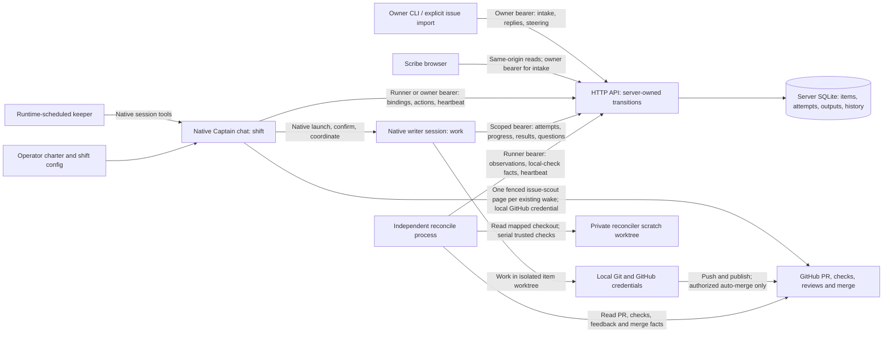
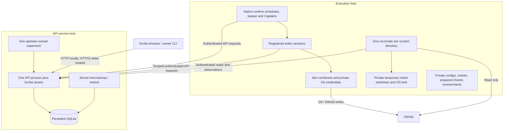

# Relay-free direct-session architecture

This implementation map describes shipped code, not proof that a particular installation has deployed it.
[SPEC.md](../SPEC.md) defines the product,
[STATE_MACHINE.md](../STATE_MACHINE.md) owns transitions, and
[direct sessions](direct-sessions.md) specifies the coordination contract.

**Relay-free does not mean server-free.** The retired relay was the Captain chat
transport used by the old scheduling loop. The HTTP API and Scribe dashboard
are still components, now supported by the packaged Go server by default.
The old `captain`, `relay` and `attended*` CLI paths,
numbered slots, runner-only PR executors and client SQLite journals are retired.
Historical decisions and pilot
results referring to them are not instructions for a second execution path.

The [native Go server](../server/README.md) implements the public
HTTP/application/schema26 SQLite families with pinned P0/D0 conformance fixtures.
Its [versioned entrypoint and existing launch adapter](go-server-release.md) are the
repository default, not proof of any installation's live engine/revision.
Python HTTP is removed; rollback uses a separate retained known-good package. Python clients,
reconciler and admin remain supported; [removal boundaries](python-server-deprecation.md)
retain shared domain/model/schema and historical oracle dependencies.
Its immutable-source/raw-wire/current-data evidence and
[owner-approved named transport limits](http-server-migration.md#411-separately-approved-named-transport-changes)
remain separate from exact-head review, required CI and installation adoption.

| Supported native boundary | Responsibility |
| --- | --- |
| `server/internal/httpapi` | Declarative route table with typed operations, per-method role/body/origin rules and handlers; scope/browser authority, exact response/error projection, Scribe/static assets and pinned documentation |
| `server/internal/contract` | Presence/default/model validation, datetime and exact receipt/usage JSON encoding |
| `server/internal/application` | Authoritative atomic workflows, writer/capacity continuation, reconciliation, usage, scouting, pickup/flags/operator projection and existing finalization/refresh jobs |
| `server/internal/sqlite` | Schema26 query/storage, connection-local PRAGMAs, admission, rollback and unknown-commit outcomes; no migration or new scheduler |
| `server/internal/instancelock` | Database-adjacent sole-instance lock |
| `server/cmd/phalanx-server`, `server/package.py`, `phalanx/deployment.py` | Versioned server-only binary/assets and explicit existing-supervisor engine selection; no live adoption or client replacement |
| `server/cmd/conformance-*`, `server/conformance` | Disposable-only fixture adapters, pinned Python oracles, raw wire/typed-store differential and package-only current-data rehearsal; no runtime Python proxy |

## Components and ownership



The arrows name the initiating caller, not an API push channel. Scribe polls the API;
Captains inspect native sessions themselves; writers submit their own results.
The reconciler also reads registered repositories and execution pages from the API.
Execution pages supply each execution's current target, publication mode and requested
target branch, so a pass does not fetch individual item details. Writer preparation
verifies the mapped checkout once before fetching and pinning the origin base; the
resulting item worktree still receives its own identity and dirty-state inspection.
It does not launch sessions, write GitHub, or merge PRs.

| Boundary | Authoritative state / responsibility | Implementation |
| --- | --- | --- |
| API and database | Items, dependencies, executions, attempts, questions/replies, reports, bindings, actions, observations and flags; atomic transitions and finalization | [Go startup](../server/cmd/phalanx-server/main.go), [application](../server/internal/application), [storage](../server/internal/sqlite); Python offline [store/admin](../phalanx/server_admin.py), shared [transitions](../phalanx/transitions.py) |
| Python API clients | One authenticated, no-redirect transport with explicit full routes, HTTP status/details and uncertain-mutation diagnostics; shared CLI JSON output | [APIClient.call](../phalanx/api_client.py), [print_json](../phalanx/json_utils.py) |
| GitHub | PR identity, actual head/base, checks, feedback, merge and deployment facts | [GitHub reader](../phalanx/github.py), [native reconciliation](../server/internal/application/reconciliation.go) |
| Captain runtime | Native launch/discovery, coordination, trust-block escalation, shift handoff and creator-owned cleanup | [shift client](../phalanx/shift.py), [Captain prompt](../phalanx/prompts/captain.md), [keeper prompt](../phalanx/prompts/keeper.md) |
| Pickup projection | Routing/pickup select only live active registrations. Request-local capacity/rework, holds and native availability snapshots feed board validators and rows; writer reads derive only their execution's flags, sharing capacity with the binding | [captains](../server/internal/application/captains.go), [pickup](../server/internal/application/pickup.go), [operator views](../server/internal/application/operator.go), [flags](../server/internal/application/flags.go) |
| Scribe browser | Shared DOM/SVG/link and request-deadline helpers, visible-page board rendering with delegated row controls, Markdown rendering, fetch/auth transport, and shell-owned response projections and form/dialog wiring. Recorded session targets are resolved by the server, not inferred by the browser. | [helpers](../phalanx/static/operator-helpers.js), [board](../phalanx/static/operator-board.js), [Markdown](../phalanx/static/operator-markdown.js), [HTTP](../phalanx/static/operator-http.js), [shell](../phalanx/static/operator-shell.js), [session targets](../phalanx/session_links.py) |
| Writer runtime | Implement, run repository checks, self-review, commit, publish, and fix its primary PR through delivery | [native writer binding](../server/internal/application/writers.go), [work CLI](../phalanx/work_cli.py), [worker prompt](../phalanx/prompts/worker.md) |
| Execution host | Mapped checkouts, isolated item worktrees, Git credentials, prepared checks environments, scoped credential files and artifacts | [workspaces](../phalanx/workspaces.py), [configuration](configuration.md) |
| Reconciler | Read provider facts independently, post timestamped observations, run trusted local checks serially and notify on owner-needed flags | [reconciler](../phalanx/reconciler.py), [validation policy](validation-policy.md) |
| Observed usage | Optional allowlisted cumulative native writer measurements, separate from lifecycle state; read-only native tools transport through existing authorized runtime passes | [contract](usage.md), [client models](../phalanx/usage_models.py), [native projection](../server/internal/application/usage.go), [schema](../phalanx/schema.py) |
| Periodic issue scouting | Owner settings, due/cursor, fenced page claims, retry and source/owner-decision metadata in server SQLite; local credential verifies configured login/ID; ordinary intake owns admitted work | [native server](../server/internal/application/scout.go), [wake client](../phalanx/issue_scout_client.py), [activation](direct-path.md#periodic-github-issue-scouting) |

Operator summary waits are selected in Go application `operator.go`: writerless queued
work uses only `pickup.decision`; otherwise Building acquisition, delivery rework/handoff,
persisted waits, prerequisites, retained-writer queue controls and unconfirmed launch
waits take precedence in that order. The projection reuses the request-local context
and performs no additional reads.

Captain list details (intents, successors, cleanup counts and ended writers) use
page-wide queries, with the 100-ended-writer limit applied separately to each Captain.
Flags share one request-local live-Captain snapshot with pickup and hold decisions;
native-session archive membership and latest overdue-work actions are also read in batches.

Execution clients never open the queue database. `server initialize`, `server backup` and `server restore`
are explicit **server-host-only administration**, not an alternative client state path.
The API and reconciler reuse the storage-free [own-process priority helper](../phalanx/priority.py);
the reconciler never imports server-host administration or queue storage for scheduling.
Local credential/pending-intent files and OS locks support launch replay and exclusion;
they are not local execution journals. Unpushed work remains on its host.
Writer display names are task-first and may collide or change. Verify the full nonce
in kickoff/metadata and the registered native ID; titles are not writer identity.
API transport loss does not gate physical work under that same live writer's verified held
allocation and authorization. The [outage protocol](writer-operations.md#control-plane-outages)
defers bookkeeping through existing fenced results and GitHub observations; it adds no local
queue, offline transitions or admission bypass.

### SQLite contention and request threads

Go's `internal/sqlite` owns transaction connections, DELETE/EXTRA/FK, alternating
writer/read-batch admission, rollback and unknown-commit errors. `internal/application`
owns atomic workflows and durable finalization/refresh jobs. Disconnect does not cancel
accepted work; shutdown drains HTTP/background work under the shared OS lock.

Both engines retain two-second SQLite busy and four-second admission bounds, not
request/header/drain deadlines. Interrupted waiters remove their counts. Contention
returns **503**, `Retry-After: 1`; retry the original key under unchanged fences.
Unknown commits require reconciliation, not blind retry. Backup can outwait busy bounds.

The retained Python reference uses synchronous request workers and an async busy-response
handler, not Go goroutines. See [native/reference transaction guidance](development.md#route-permissions-and-transactions),
[contention tests](../tests/test_contention.py) and the [production probe](../tests/envelope_probe.py).
Unit fault timings do not change safety semantics; [adoption remains operator-owned](deployment.md#standing-authority-for-compatible-upgrades).

## Intake and supported commands

The [CLI dispatcher](../phalanx/__main__.py) exposes `register`, `intake`, `ingest-issue`,
`inspect`, `inbox`, `reply`, `cancel`, `onboard`, `shift`, `work`, `reconcile`, `muster`,
`deploy` and server-host `server initialize|backup|restore`. `phx` in the guides is a configured
local shorthand, not a separately installed executable.

- Owner `intake`, the owner API and Scribe's **New work item** use the same intake
  contract. Intake defaults to `checked_in`; choose `report`, `ready_for_check_in`
  or a draft publication ceiling explicitly.
- `ingest-issue` reads a registered github.com issue/comments with the local GitHub
  credential and submits an immutable snapshot. It is not a webhook, poller or sync.
- Optional periodic scouting is a separate, owner-enabled part of `shift wake`, with a
  durable server cursor and no separate scout session/scheduler. Other-author decisions
  use Scribe Needs you. Claim/completion/failure and metadata survive Captain rotation;
  bodies are only stored in admitted work, not scout diagnostics.
- `onboard` registers/verifies a remote, clone, mapping and proposed validation entry.
  The operator still prepares checks environments, copies reconciler mappings and
  grants runtime trust. It does not start sessions.
- `shift` is a client used **inside a native Captain chat**, not a background Captain
  loop. Runtime schedules wake Captains and the keeper. `shift current` reads the server's
  unique live active registration across all history; native tools verify its binding/link
  before off-shift chats forward owner input. The tracked
  [forwarding section](../phalanx/prompts/forwarding.md) is composed into Captain/keeper prompts
  and handoffs; retained chats require an explicit relay after deployment.
  The Captain prompt owns coordination, rotation, startup and creator-cleanup rules; the keeper
  loads those sections for recovery, and the wake briefing resumes that canonical workflow.
  Shared rules are referenced rather than copied into each prompt.
- `work` runs from the item's worktree and reads its scoped credential from the Git
  directory. Do not copy it, expose it or substitute the Captain's runner token.
  `work question` reuses the versioned result/question/reply path in `intake`/`waits`:
  the bound writer may omit an attempt only for a structured delivery external-wait question.
  The existing inbox/Scribe Needs-you projection exposes it; the owner reply queues that
  same writer's next delivery attempt without a parallel journal or scheduler.
- `muster status` discovers existing configuration and reads authenticated API status.
  `deploy init` separately creates new-install templates; neither is a process watchdog.

See [installation](install.md), [work items](work-items.md), [writer operations](writer-operations.md)
and [API reference](api.md) for executable examples and authentication.

Direct clients share no-redirect HTTP and API URL validation in `api_client.py`,
checkout-confined Git execution in `git.py`, and JSON decoding/atomic writes in `json_utils.py`.
Checkout identity verification uses `WorkspaceManager` (configured origin, before transport rewrites);
server flags use `flag_models.flag`, and GitHub remote recognition uses `pr_models.github_repository`.

## One writer, separately fenced stages

```mermaid
sequenceDiagram
    accTitle: Writer launch, stage results and delivery verification
    accDescr: A Captain registers and confirms one native writer. Separately fenced stage results advance through publication. The reconciler posts GitHub facts and the API verifies output.
    participant C as Native Captain
    participant A as HTTP API and SQLite
    participant W as Native writer in item worktree
    participant G as GitHub
    participant R as Reconciler
    C->>C: Verify checkout/base, prepare worktree and pending nonce/credential
    C->>A: Register writer intent (expected version, token digest)
    A-->>C: Binding and eligible first attempt
    C->>W: Launch once by nonce using native tools
    C->>A: Confirm native session ID/link
    W->>A: work status / next
    loop Development and self-review
        W->>W: Perform stage, repository checks/review where required
        W->>A: Submit result pinned to attempt, stage and version
        A-->>W: End attempt, bind next runnable attempt or wait
    end
    W->>G: Push item branch, open or reuse one primary PR at explicit base
    W->>A: Publication result with primary PR URL
    A-->>W: Delivery wait, no open attempt, writer stays registered
    opt Actionable delivery flags
        W->>A: Request Building; wait for granted allocation
        W->>G: Fix checks, feedback or conflicts on the same PR
        W->>A: Release Building with reviewed publication head
    end
    R->>G: Read exact PR, checks, feedback and verified merge facts
    R->>A: Timestamped observation (no worker attempt)
    A->>A: Derive flags, verify requested output, close and end writer
    Note over A,G: Ready-only stops before owner merge, checked-in waits for GitHub merge
```

PR stages are `development -> self_review -> publication -> delivery`. Self-review
findings return to development. Publication records one primary PR, then delivery
normally waits without an open attempt. Ready-mode delivery fixes stay on that PR,
without stage results; after an owner reply queues delivery, the writer resumes,
acts on the reply and submits success. A changed draft-only head instead queues
self-review, then republication of the same PR URL.

Reports use `report_drafting -> report_review -> report_storage`. Review and storage
name the exact content-addressed draft. The server stores the reviewed report and
terminal output atomically, retrying finalization without redrafting.

Status is separate from stage. Input, dependency, retry and external waits retain
the writer; pause blocks new registrations and Building acquisitions, not an allocated writer's stage continuation.
Writer bindings have no timed expiry. Nonce replay, expected versions and stopped-session
attestation prevent duplicate writers and stale submissions, not runtime trust or review.
Attempts contain only stage timing and identity; results check the live writer-to-attempt
binding in the write transaction. There are no runner leases, scheduled external rechecks
or separate historical-worker records. Scribe gets native session identity from writers.

The writer self-review stage is not a second independent PR reviewer. GitHub reviews,
checks and repository rules still apply. The generated writer instructions require the
[merge decision gates](writer-operations.md#merge-decision-before-auto-merge) **before**
merge or auto-merge activation.
Publication can finish first with auto-merge off and the same writer waiting in delivery.
This prompt boundary adds no engine approval predicate, review agent or lifecycle stage.
Self-review and previous-head/content-only approval cannot satisfy independent final review.
The reconciler's observations do not certify that review. Trusted local-check failures
are flags, not another Phalanx delivery gate. Required ready checks come from trusted
policy; missing policy is not success. A verified merge into the target by anyone
completes either PR target, with `merge` or combined `squash_or_rebase` provenance.
Ready-only writers never merge or enable auto-merge. Later owner merges can enrich
completed ready outputs and release check-in dependencies without restarting writers.
Optional deployment checks observe the delivered **merge commit**; they are flags,
not stages, and never reopen delivery.

Owner-authenticated `intake.steer` also allows acceptance-criteria-only edits during attempt-free
delivery external waits, using the existing version fence and before/after timeline audit. This
supports [explicit ordinary-performance classification](writer-operations.md#bounded-performance-work)
without replacing writers or changing lifecycle/capacity/ceilings. Captain material-event messages
reuse existing bounded reconciliation/refill; there is no event bus or new scheduler. Runtime
installation, complete schema rehearsal and retained-instruction adoption remain
[separate operator receipts](deployment.md#coordination-policy-adoption-boundary), not source-merge evidence.

## Deployment and recovery boundaries



These are ownership boundaries, not a claim that multiple hosts are deployed.
Local first means API and execution host may be the same machine. The API does not
need checkout mappings or GitHub credentials. Hosting requires HTTPS, persistent
storage, authentication and backups; multi-user tenancy and multi-device handoff
remain separate work.

[Deployment tooling](deployment.md) provides foreground service entrypoints and a
database-adjacent OS lock owned by the Go child for `deploy run server`.
One supervisor owns each service. Reconciler scratch locking is independent.
Templates do not install a supervisor, launch sessions or deploy themselves. Adoption
on an existing installation is a reviewed service-owner operation preserving paths,
database, tokens, active writers and capacity; never initialize a replacement database
or restart another owner's services from a writer.
The [Windows API launcher](../phalanx/deployment.py) and native Go entrypoint normalize only their own inherited
background CPU priority to Normal before serving; the operator configures the existing
supervisor at Normal as well. This does not change writer capacity or other processes.

After an API restart, bindings, attempts, replies and outputs survive in SQLite.
After a Captain loss, existing writers and the reconciler continue; a keeper/fresh
Captain reconciles API, GitHub and native inventory. `shift.launch` prepares the worktree
and persists/replays a reservation; the Captain's native create and writer confirmation
are separate effects, not a transaction. Complete those three steps per item before
reserving another. After interruption, search fresh full inventory and verify the full
nonce in kickoff/metadata. Confirm a match, or replay the same reservation only after
proving absence and no in-flight native create. Inconclusive inventory/replay is an
explicit blocker. Scribe and Captain status show reservation age and the recovery
action without claiming native execution; the existing ten-minute alert notifies the
owner. No background launcher or timeout-based release is introduced.
Replace only the exact stopped
writer after preserving local work and accounting for external effects. An API HTTP 401
ends that writer's control access; inspect terminal state through an authorized
Captain/owner, not by manufacturing a new credential. Stale heartbeat/progress flags
alone never prove a process stopped. Follow [resume](resume.md) and [recovery](recovery.md).

Use the [service-owner adoption procedure](deployment.md#coordination-policy-adoption-boundary)
for code, schema and retained instructions; source merge is not installation evidence.

### Shipped code is not installation state

Scribe briefs are allowlisted from the existing request only on current-item/execution
detail reads. Owner-only display titles use the separate append-only `item_titles` table,
with their own revision fence and audit identity/time. They do not mutate work scope,
execution state/version, attempts or outputs. The insert invalidates board ETags, so
unchanged polls remain no-ops while actual title changes refresh normally. This source
needs the API, canonical schema and static assets installed before the route is available.
Only after deployment may an owner read the title revision, PUT the requested title
with a stable idempotency key and read back both metadata and the Scribe caption. Never
use queued-only goal Steering, stage interruption or direct database edits as a substitute.

The two writer limits are persisted in `dispatch_settings`: `max_building_writers` (Building,
initially five) and `max_writers` (Total, initially ten on new installs), editable as an atomic
pair by the owner. `writers.building` is the authoritative allocation; `building_requested_at`
persists rework waits and FIFO preference for eligible PR fixes. Registration/acquisition and
release run inside the same SQLite write transaction as writer/stage changes. Successful
self-review releases Building into publication; delivery fixes explicitly reacquire it.
`executions.handoff_head` fences the reviewed commit awaiting publication across restart.
A mismatched open head has a visible `head_drift` flag and board wait. GitHub merges remain
authoritative; ending/withdrawing/replacing the writer clears the handoff for recovery.
Counts, board waits and dispatch-overdue/backlog reporting use `dispatch`'s same state/helpers,
not stage-derived guesses or a second budget. Intents and waiting writers retain Total.
`shift launch` supplies no limit, and charters reject concurrency keys. Existing stores
preserve saved Total and conservative allocations under [reviewed adoption](deployment.md#existing-runtime-reviewed-adoption-not-a-rename).
Captain timing and succession are documented once in [the operating guide](direct-path.md#captain-shifts-and-handoff);
the [API reference](api.md#captain-workflow-reinforcement) specifies acknowledgement fields.
Likewise tokenless local-board actions require both shipped code and verified deployment:
explicit `PHALANX_LOCAL_BOARD=1`, a loopback-only listener, direct loopback peer and local
Host, with exact same-origin writes and no forwarding headers. Narrow `/operator/api/`
creation and canonical settings adapters share this authorization helper; `/v1` intake,
replies, settings and other writes retain their documented bearer roles. The server never
injects its owner credential into the browser. See [local-board setup](work-items.md#operator-work-board).
